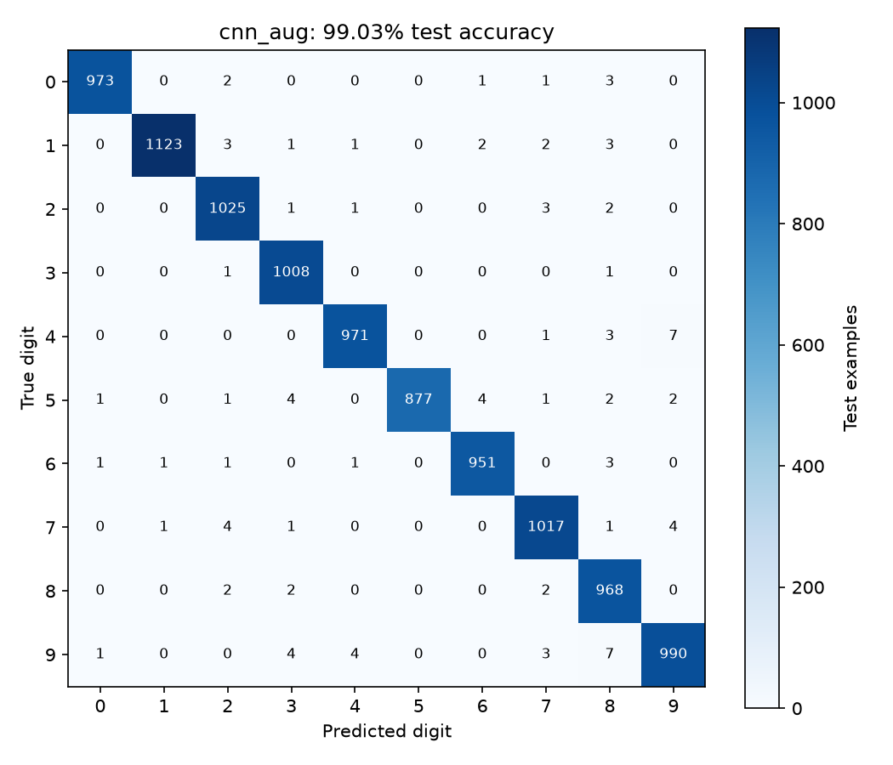

# MNIST Recognition by Neural Networks

I trained an MLP, a CNN, and a small Transformer encoder to recognize handwritten digits. I also compared the CNN with and without image augmentation.

## Results

| Model | Test accuracy |
|---|---:|
| MLP | 97.46% |
| CNN | 98.72% |
| CNN with augmentation | 99.03% |
| Transformer encoder | 96.68% |

The augmented CNN performed best in this run, with 9,903 correct predictions out of 10,000. Its accuracy was 0.31 percentage points higher than the baseline CNN.

Full scores are saved in [test_results.json](results/test_results.json).

## Training

I split the official 60,000 training images into 55,000 training examples and 5,000 validation examples using seed 42. Each model trained for eight epochs with Adam, learning rate 0.001, batch size 256, and cross-entropy loss. Pixels were scaled to 0 through 1 and normalized using the training mean and standard deviation.

I kept the checkpoint with the best validation accuracy, using validation loss to break ties, then evaluated it on the official 10,000 test images.

- MLP: one 128-unit hidden layer with ReLU.
- CNN: two convolution and pooling blocks, then a 64-unit hidden layer.
- Transformer: sixteen 7 by 7 patches, 64-dimensional embeddings, and two encoder layers with four attention heads.
- Augmented CNN: the same CNN with random rotations within 10 degrees and translations within 8% of image size during training.

The selected checkpoints and per-epoch training histories are included.

## Run

Use Python 3.12:

```bash
python3.12 -m venv .venv
source .venv/bin/activate
python -m pip install -r requirements.txt
python train.py
python test.py
```

MNIST downloads into `data/`. The scripts use an available GPU or CPU. To test the included checkpoints without training again, run `python test.py`. Use `--device cpu` to force CPU execution.

## Confusion matrix

The plot shows the augmented CNN, which had the highest validation accuracy.


